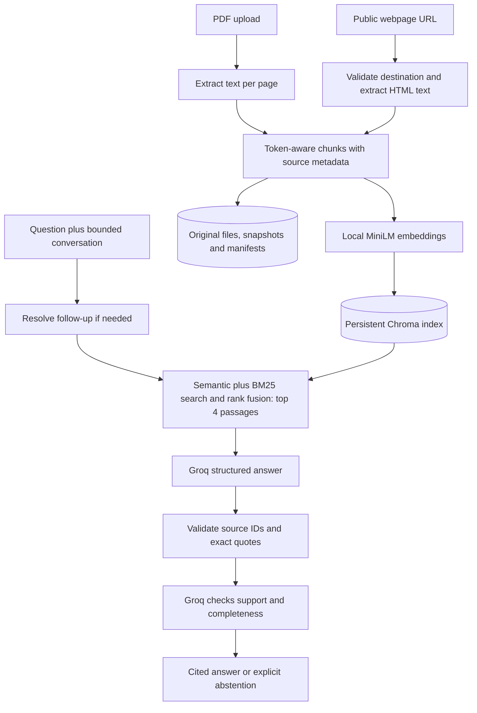

# Architecture and design decisions

Streamlit owns the UI and session transcript; LangChain connects splitting, embeddings,
Chroma retrieval, and Groq. No separate API server is needed for this local project.
Indexing runs on CPU. Only questions, retrieved passages, and bounded conversation
for follow-up resolution leave the machine for Groq.

Chunks stay within PDF pages, preserving exact page positions for citations. Token
budgets use the embedding tokenizer to prevent silent truncation. A manifest is
committed after indexing; retrieval excludes incomplete sources. Model/chunk settings
select a separate collection, so incompatible embeddings are never mixed.

History resolves references, then fresh retrieval supplies the evidence. Keeping prior
answers out of the generation evidence avoids treating earlier model output as a source.
Quote matching verifies provenance; a second model call checks support and completeness.
One incomplete draft can be repaired and checked again. A local BM25 index supplements
semantic retrieval with exact terms; cached query embeddings avoid repeated local inference. Neither proves
correctness. Model errors, poor extraction, missing retrieval, and prompt injection remain
possible. Distances are retrieval scores, not confidence percentages.

The current app shares one library among sessions and expects one process per data
directory. Conversation history is session-only. OCR, table reconstruction, reranking,
background jobs, user accounts, and per-user storage are future work.
