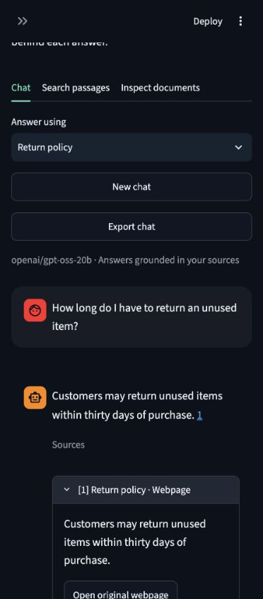

# Retrieval, reliability, speed, and chat improvements

Updated 21 October 2026. The default remains `openai/gpt-oss-20b` on Groq with local
MiniLM embeddings and persistent Chroma. These are application/pipeline changes;
no model weights were trained and no document reindexing is needed.

## What changed

- Chat retrieval combines twelve semantic candidates and BM25 keyword candidates
  using reciprocal-rank fusion, selecting four distinct passages. The keyword index
  follows committed sources and rebuilds after library changes. Exact technical terms
  and identifiers can now contribute even when semantic search misses them.
- Query embeddings are cached in memory (128 entries per model instance), and Groq
  clients are reused. Explicit standalone topic/definition requests avoid the extra
  history-rewrite call. Ambiguous questions and follow-ups still use history resolution.
- Answer generation uses a JSON schema on the supported GPT-OSS models. A provider
  JSON-generation rejection can fall back once to JSON-object mode. Local schema,
  source-ID, and quote validation still apply. Checker/rewrite requests use JSON mode.
- A separate completeness flag supplements the grounding check. A supported but
  incomplete draft can be repaired once, within a total two-generation-attempt budget.
  Malformed checker responses retry once. Provider/SDK retries can add requests.
- Negative answers are explicitly distinguished from abstention. A supported “no”
  uses `answerable=true`; insufficient evidence uses false with no statements. Inconsistent
  responses get one corrective attempt before the answer is withheld.
- PDF whitespace differences are restored to the original source span. Quotes with
  altered words or punctuation remain invalid. Unvalidated draft text is never displayed.
- Chat now has Enter-to-send, conversation bubbles, compact source cards, New chat,
  Export chat with source references, response timing, and Retry answer. Retrying replaces
  the failed turn, and normal widget reruns do not make duplicate answer requests.

## Validation

The final [16-case run](../evaluation/quality-results.md) includes the original ten
questions and six harder cases about exclusions, conditions, expiry, and restrictions.
It uses eight small authored HTML fixtures and a fresh temporary index, without user uploads.

| Check | Result |
| --- | --- |
| Expected answer/abstention behavior | 16/16 |
| Expected-source recall@4 | 100% over 13 answerable cases |
| Required sources cited | 13/13 answerable cases |
| Provider exceptions / final validation failures | 0 / 0 in this run |
| Offline suite | 81 passed, two live tests excluded |
| Live Groq smoke | Passed: supported answer, follow-up, unknown fact, injected document instruction |
| Lint / installed dependencies | Passed |

### Qualitative review

This is an assistant review, not an independent human assessment. The final answers
preserve the unwanted-item refund condition (q5), eligible-item requirement and inactivity
period for rewards (h3), inspection/payment conditions (h5), and final-sale restriction
(h6). The damaged-product delivery-fee question (h2) correctly abstains: the fixture only
specifies unwanted-item returns. All three unknown-fact questions abstain.

The general warranty answer (q3) still omits accidental/water-damage exclusions, although
its coverage and duration claims are supported. The completeness checker accepted this
omission. A direct exclusions question (h1) gets the correct answer. This demonstrates
why behavior, source recall, and term checks are not semantic accuracy. Review conditions
and exceptions in source quotes. A broader corpus and independent review remain necessary
before making general accuracy claims.

### Timing

The median over the original ten questions was **1.55 seconds** in the final run,
compared with **2.32 seconds** in the earlier saved baseline. The median over all sixteen
questions was **6.27 seconds**: later requests were slower. These are single, sequential
API runs at different times, not a controlled speed benchmark. Network/provider variance
and quota effects were not isolated. Initial model loading/seeding and the optional
three-second between-case interval are outside per-question timing. Cold UI startup
can be slower. Failures needing repair also add latency.

A normal supported answer uses two logical pipeline calls; dependent follow-ups add a
rewrite. Counts exclude provider fallback and SDK retries. The two-call grounding path
is retained to check answers before showing them.

## Reproduce

```bash
HF_HUB_OFFLINE=1 .venv/bin/python -m pytest -m 'not live' -q
HF_HUB_OFFLINE=1 RUN_GROQ_LIVE=1 .venv/bin/python -m pytest tests/test_groq_live.py -q
HF_HUB_OFFLINE=1 .venv/bin/python -m evaluation.run --include-challenges --output evaluation/quality-results.json --interval 3
```

The final report is `quality-results.*`. `results.*` is the original baseline;
`improved-results.*` and `challenge-results.*` are intermediate development runs.
Results can change on rerun even with temperature zero. The JSON report includes
questions, reference answers, retrieved text, evidence, model/settings, fixture hash,
latency, and logical pipeline-call counts.


